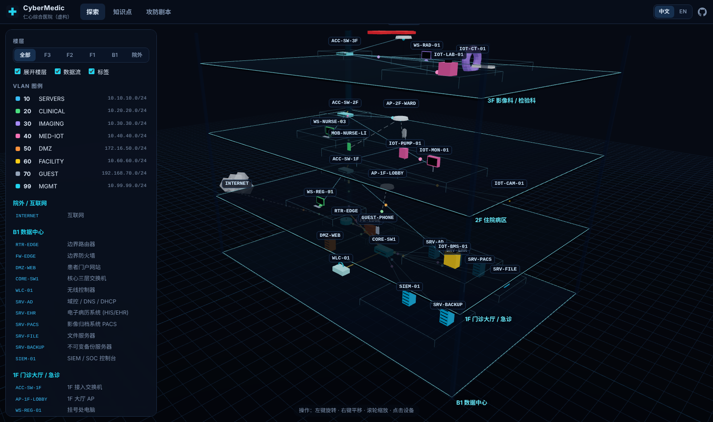
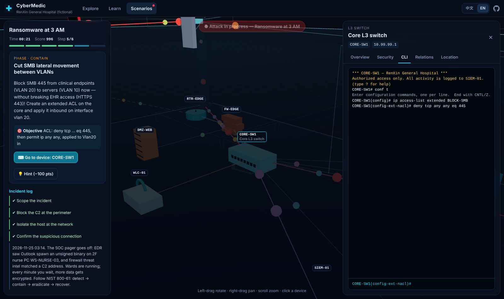
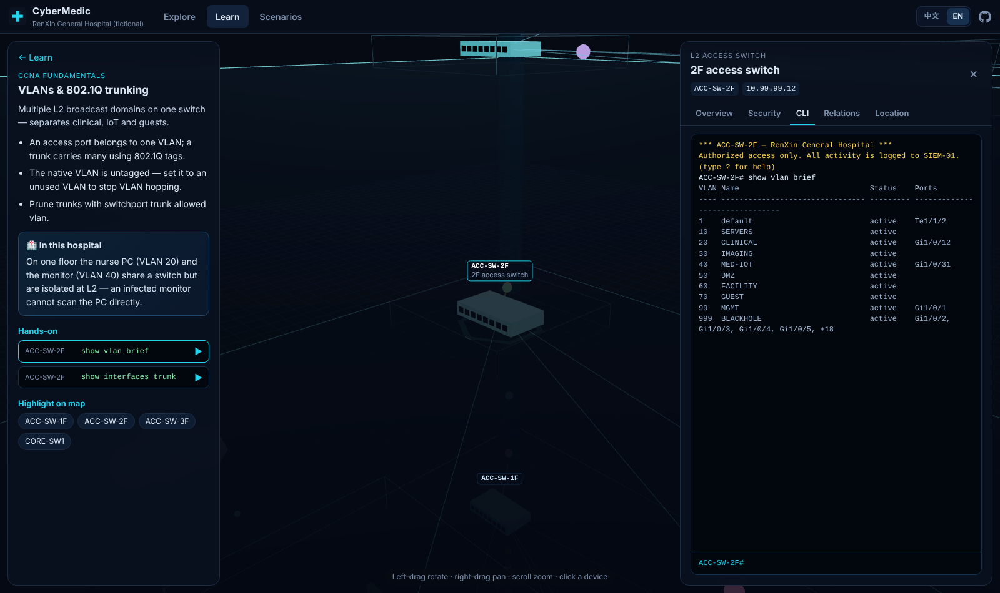

# CyberMedic · 医院网络防御模拟器

**[English](#english) | [中文](#中文)**



---

## English

CyberMedic is a browser-based 3D simulator of a fictional hospital network, **RenXin General Hospital**. It is built for people getting into **infrastructure and healthcare cybersecurity**. You can walk through every floor, click any device to see how it fits into the network, practise in a simulated CLI, and defend the hospital against scripted attacks one command at a time.

> **Live demo:** `https://silchenn.github.io/cybermedic/` (deployed automatically by GitHub Actions)

### Features

| Area | What you get |
| --- | --- |
| **3D hospital** | 4 levels (B1 data center, 1F lobby/ER, 2F ward, 3F imaging/lab) plus the Internet edge. 29 devices (plus 2 hidden threat actors that appear during drills), low-poly procedural models, an exploded-floor view, and per-floor filtering. |
| **Live data flows** | Animated packets for 17 real hospital flows: EHR over HTTPS, DNS, DHCP relay, Kerberos, HL7 from pumps and monitors, DICOM from CT to PACS, CAPWAP, syslog, PAT for guest traffic, and DMZ → EHR API calls. Paths come from BFS over the real topology. |
| **Device inspector** | Overview, Security (risk score, findings, remediations, existing controls), CLI, Relations (physical ports, logical flows, same-VLAN peers), and Location (room plus a 2D floor plan). |
| **Simulated CLIs** | Cisco-IOS-style switches and routers with abbreviations (`sh ip int br`, `conf t`, `int gi1/0/12`), a WLC, an ASA-style firewall, Linux, Windows, PowerShell/AD, embedded IoT shells, and a SIEM query console. Commands change network state: shutting a port really cuts the link, and ACLs really block traffic. |
| **Knowledge base** | 21 topics: OSI, subnetting, VLAN/802.1Q, inter-VLAN routing, STP, routing/OSPF, DHCP, DNS, NAT/PAT, ACLs, L2 security, syslog/SNMP/NTP, QoS, AP modes/WLC, wireless security, AAA/802.1X, firewalls/DMZ, IoMT segmentation, ransomware IR, HL7/FHIR, and DICOM/PACS. Each topic highlights the related devices in 3D and includes one-click hands-on commands. |
| **Attack/defense drills** | **Ransomware at 3 AM** (6 steps, NIST 800-61) and **Evil Twin in the lobby** (6 steps). Each comes with a scored timer, progressive hints, warnings when you make a risky move (for example, an ACL that would cut every nurse off the EHR), learning cards after each step, MITRE ATT&CK mapping, and a debrief. |
| **Bilingual** | Full Chinese / English UI and content, switchable at any time. |



### Tech stack

React 18 · TypeScript · Three.js via React Three Fiber + drei · Zustand · Vite. It is a static build hosted on GitHub Pages, with no backend.

### Run locally

```bash
npm install
npm run dev       # http://localhost:5173
npm test          # headless run-through of both scenarios + CLI smoke checks
npm run build     # type-check + production build into dist/
```

### Project layout

```
src/
  data/network.ts     hospital topology: zones, VLANs, devices, links, flows
  data/knowledge.ts   knowledge-base topics
  sim/cli.ts          CLI emulators (IOS, WLC, firewall, Linux, Windows, PowerShell, IoT, SIEM)
  sim/reach.ts        reachability / segmentation / ACL model used by ping & traceroute
  sim/scenarios.ts    attack/defense drills (steps, checks, hostile flows, debrief)
  scene/              3D scene, device meshes, packet animation, camera rig
  ui/                 sidebar, device inspector, terminal
scripts/smoke.ts      end-to-end scenario test
```

### Adding a scenario

Add an entry to `SCENARIOS` in `src/sim/scenarios.ts`. Each step defines a target device, bilingual text, hints, and a `check(state)` predicate over the simulated network state, so players can reach the goal with any valid command sequence. Then add the run-through to `scripts/smoke.ts`.

### Roadmap

- More drills: DNS tunnelling exfiltration, ARP-spoofing MITM, a compromised vendor VPN into the BMS, a medical-device firmware attack, and a DDoS on the patient portal
- Branch clinic with OSPF/SD-WAN, IPv6, EtherChannel
- Packet-capture viewer (Wireshark-style) for selected flows
- Saved progress and achievements

### Disclaimer

This is an educational simulation. The hospital, devices, vendor models, IPs (RFC 5737 documentation ranges), people and incidents are all fictional. The CLIs are simplified emulations and may differ from real vendor syntax.

---

## 中文

CyberMedic 是一个在浏览器里运行的 3D 医院网络模拟器，模拟的是一家虚构医院"**仁心综合医院**"。它面向想进入**基础设施与医疗行业网络安全**领域的学习者。你可以逐层查看医院，点击任意设备了解它在网络中的位置和作用，在模拟命令行里动手练习，并在攻防剧本中一条命令一条命令地守住医院。

> **在线体验：** `https://silchenn.github.io/cybermedic/`（由 GitHub Actions 自动部署）

### 功能

- **3D 医院全景**：B1 数据中心、1F 门诊大厅/急诊、2F 住院病区、3F 影像/检验，加上院外互联网边界；共 29 台设备（另有 2 个只在剧本中出现的攻击方设备），支持"展开楼层"视图和按楼层筛选。
- **实时数据流**：动画展示 17 条真实的医院业务流，包括电子病历、DNS、DHCP 中继、Kerberos、HL7（输液泵/监护仪）、DICOM（CT→PACS）、CAPWAP、Syslog、访客 PAT、DMZ→EHR API。路径按真实拓扑计算。
- **设备详情**：每台设备有五个页签：
  - 概览
  - 安全：风险评分、问题、修复建议、已有防护
  - 命令行
  - 关系：物理端口、逻辑数据流、同 VLAN 设备
  - 位置：房间和 2D 平面图
- **模拟 CLI**：
  - 覆盖思科 IOS 风格交换机/路由器（支持 `sh ip int br`、`conf t` 等缩写）、WLC、ASA 风格防火墙、Linux、Windows、PowerShell/AD、物联网设备 Shell 和 SIEM 查询台。
  - 命令会真实改变网络状态：关掉端口，链路就会断；加上 ACL，流量就会被拦截。
- **知识点**：21 个主题，覆盖 CCNA 核心内容、无线、安全应急响应和医疗协议（HL7、DICOM）。点开知识点会在 3D 场景中高亮相关设备，并提供一键动手命令。
- **攻防剧本**：
  - 两个剧本：**凌晨三点的勒索软件**（NIST 800-61 流程）和**大厅里的 Evil Twin**。
  - 都有计分计时、逐级提示和每步学习卡片，并附 MITRE ATT&CK 映射与复盘。
  - 危险操作会给出警告，例如写出会让全院护士打不开病历的 ACL。
- **中英双语**：界面和内容都可以随时切换语言。



### 本地运行

```bash
npm install
npm run dev       # 访问 http://localhost:5173
npm test          # 无头跑通两个剧本 + CLI 冒烟测试
npm run build     # 类型检查 + 生产构建
```

### 免责声明

本项目仅用于教学模拟。医院、设备、厂商型号、IP（使用 RFC 5737 文档保留地址）、人物和事件均为虚构。CLI 是简化的模拟，可能与真实厂商的语法不同。

## License

[MIT](LICENSE)
